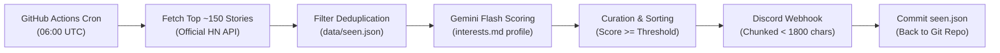

# HN Filter 🗞️🤖

> An automated, zero-maintenance Hacker News curator that scores daily stories against your personal interest profile using **Gemini Flash** structured outputs and delivers a clean morning digest to your **Discord** channel.

Runs 100% free on **GitHub Actions** with zero servers, zero databases, and zero ongoing costs.

---

## ⚡ How It Works



1. **Fetch**: Reads the top 150 stories from the official [Hacker News Firebase API](https://github.com/HackerNews/API) with polite concurrency (`asyncio.Semaphore(10)`) and retry backoff.
2. **Deduplicate**: Compares IDs against [`data/seen.json`](file:///home/ameen/hnfilter/data/seen.json) to ensure you **never receive the same story twice**. If nothing is new, it exits early to save LLM tokens.
3. **Score**: Batches new titles and passes them alongside [`interests.md`](file:///home/ameen/hnfilter/interests.md) to **Gemini 2.5 Flash / Flash-Lite**. Uses official **Structured Outputs** (`response_schema=VerdictBatch`) so every story receives a guaranteed `[0–10]` score and a concise one-line reason.
4. **Curate**: Filters stories meeting your score threshold (default: `7/10`), sorts by relevance, and caps at the top picks.
5. **Deliver**: Formats stories with link preview suppression (`<url>`) and splits messages under Discord's 2,000-character limit without ever cutting a story block in half.
6. **Persist**: Atomically updates `data/seen.json`, prunes entries older than 14 days, and commits the state back to the GitHub repository.

---

## 🛠️ The Stack

| Component | Technology | Rationale |
|---|---|---|
| **Language** | Python 3.12+ | Modern async typing, robust standard library |
| **HTTP Client** | [`httpx`](https://www.python-httpx.org/) | Async HTTP/2 requests with connection pooling and timeouts |
| **Validation** | [`pydantic`](https://docs.pydantic.dev/) v2 & `pydantic-settings` | Type coercion, boundary checks, and `.env` parsing |
| **AI Scoring** | [`google-genai`](https://github.com/google-gemini/google-genai) | Official Google SDK; native JSON schema enforcement |
| **LLM Model** | Gemini 2.5 Flash / 3.5 Flash-Lite | Free-tier quota on Google AI Studio; fast technical reasoning |
| **Scheduler** | GitHub Actions Cron | Free cloud runtime; automated morning triggers |
| **Storage** | Git-backed `data/seen.json` | Serverless; daily commit also keeps the GitHub Actions schedule active |
| **Notifications**| Discord Webhooks | Mobile & desktop push notifications with zero bot setup |
| **Testing** | `pytest`, `pytest-asyncio`, `respx` | 100% mocked external API unit & integration test suite |

---

## 🚀 Fork & Set Up in 5 Minutes

### Step 1: Fork the Repository
Click the **Fork** button at the top right of this repository to create your own copy.

### Step 2: Get Your Free API Keys
1. **Google Gemini API Key**:
   - Go to **[Google AI Studio](https://aistudio.google.com/app/apikey)**.
   - Click **Create API key** (free tier, no credit card required).
2. **Discord Webhook URL**:
   - Open Discord and select or create a private channel (e.g., `#hn-digest`).
   - Go to **Channel Settings ⚙️** > **Integrations** > **Webhooks** > **New Webhook**.
   - Click **Copy Webhook URL**.

### Step 3: Add Secrets to Your GitHub Repository
1. In your forked repository, go to **Settings** > **Secrets and variables** > **Actions**.
2. Click **New repository secret** and add:
   - `GEMINI_API_KEY`: *(Your Google AI Studio key)*
   - `DISCORD_WEBHOOK_URL`: *(Your Discord webhook URL)*
3. *(Optional)* Under **Variables**, you can add `GEMINI_MODEL` (e.g. `gemini-2.5-flash` or `gemini-3.5-flash-lite`). If omitted, it defaults to `gemini-2.5-flash`.

### Step 4: Test with a Manual Trigger
1. Go to the **Actions** tab in your repository.
2. Select **Daily HN Digest** on the left menu.
3. Click **Run workflow** > **Run workflow**.
4. Check your Discord channel — your first curated digest will arrive in seconds!

---

## 🎯 How to Tweak Your Personal Filter

The AI scoring is guided entirely by [`interests.md`](file:///home/ameen/hnfilter/interests.md). Edit this file directly in GitHub or locally to reflect exactly what you care about.

### Example: Software Engineering & Systems (Default)
```markdown
I read Hacker News for software engineering. I want stories about:
- Systems programming, C/C++, Rust, Go, compilers, OS internals, performance engineering
- Python tooling, libraries, internals, and modern frameworks
- Docker, Linux, DevOps, CI/CD, self-hosting, infrastructure
- LLM and AI engineering (practical applications, architecture, tooling, not hype)
- Security write-ups, vulnerability analysis, and incident postmortems

I do NOT want:
- Startup funding rounds, VC commentary, acquisitions
- Cryptocurrency prices, speculative trading, tokenomics
- Politics, culture wars, celebrity/industry gossip
- Generic "AI will replace X" opinion essays
- Product announcements with no technical content or code
```

### Example: Frontend & Web Dev Profile
```markdown
I want stories about:
- Modern CSS (container queries, animations, modern layout engines)
- React, Next.js, TypeScript internals, Vite, and frontend tooling
- Web browser engines (Chromium, WebKit, Gecko) and web standards
- WebAssembly (WASM), WebGPU, Canvas, and browser performance
- UX architecture, design systems, and web accessibility (a11y)

I do NOT want:
- Low-level kernel or embedded hardware posts
- AI hype, business gossip, or VC funding announcements
```

### Example: Data Science & AI Engineering Profile
```markdown
I want stories about:
- Novel deep learning architectures, transformer optimizations, CUDA, quantization
- Data engineering, DuckDB, Polars, Apache Arrow, Postgres internals
- Real-world AI engineering case studies, evals, benchmarks, and reproducibility
- Open-weights models, local LLM inference (llama.cpp, vLLM)

I do NOT want:
- Philosophical AI doom / hype essays with no code or benchmarks
- Crypto, generic web development tutorials, or business pitch decks
```

---

## ⚙️ Tuneable Settings

You can customize parameters either via environment variables or in [`.env`](file:///home/ameen/hnfilter/.env.example):

| Setting | Default | Description |
|---|---|---|
| `THRESHOLD` | `7` | Minimum Gemini score (0–10) required for a story to be included in the digest. |
| `FETCH_LIMIT` | `150` | How many top stories from Hacker News to inspect. |
| `MIN_HN_SCORE` | `10` | Minimum HN community points before considering a story. |
| `MAX_ITEMS` | `10` | Maximum number of top picks delivered in each digest. |
| `BATCH_SIZE` | `40` | Number of story titles passed to Gemini per API call (~4 calls/day for 150 items). |
| `GEMINI_MODEL`| `gemini-2.5-flash` | Model ID from Google AI Studio (e.g. `gemini-2.5-flash` or `gemini-3.5-flash-lite`). |

---

## 💻 Local Development & Testing

### 1. Setup Environment
```bash
git clone https://github.com/your-username/HN-filter.git
cd HN-filter

python3 -m venv .venv
source .venv/bin/activate
pip install -r requirements-dev.txt
```

### 2. Configure Local `.env`
```bash
cp .env.example .env
# Edit .env with your GEMINI_API_KEY and DISCORD_WEBHOOK_URL
```

### 3. Run the Automated Test Suite
```bash
# Run 70 unit and integration tests with coverage assertion
pytest -v --cov=hnfilter

# Run linter and type checker
ruff check .
mypy hnfilter
```

### 4. Run a Safe Dry Run
```bash
# Evaluates live HN stories against your interests.md and prints a preview to stdout
# (Does NOT post to Discord and does NOT modify data/seen.json)
python -m hnfilter.main --dry-run --limit 30 --threshold 7
```

---

## 🛡️ Resilience & Production Edge Cases

- **Rate Limits & Backoff**: Automatically handles Gemini HTTP 429 quota spikes and Discord rate limits using exponential backoff.
- **Atomic State Persistence**: Writes to a PID-tagged temporary file and swaps it into place using atomic POSIX `os.replace`, guaranteeing `seen.json` is never corrupted during a crash.
- **Fail-Safe Rollback**: If scoring or Discord delivery fails, `seen.json` is **not** updated, ensuring missed stories are automatically re-evaluated on the next run.
- **Automatic Pruning**: Retains story history for 14 days and automatically drops older entries to keep storage lightweight and bounded forever.
- **GitHub Inactivity Keepalive**: Scheduled GitHub Actions workflows automatically pause if a repo has no commits for 60 days. The automated daily `seen.json` commit keeps the repository perpetually active without manual intervention.

---

## 📄 License

MIT © [Ameen](https://github.com/ameenra)
